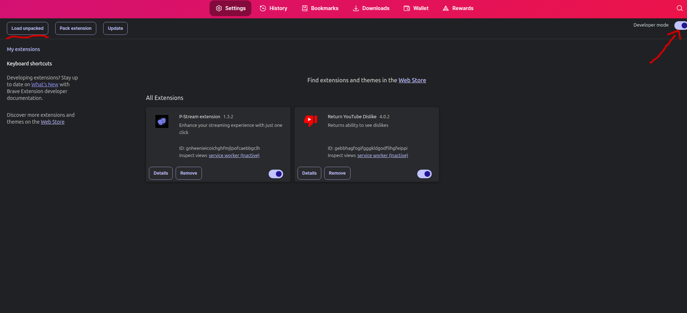
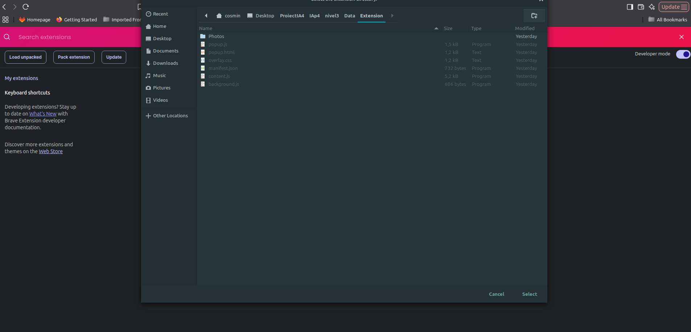
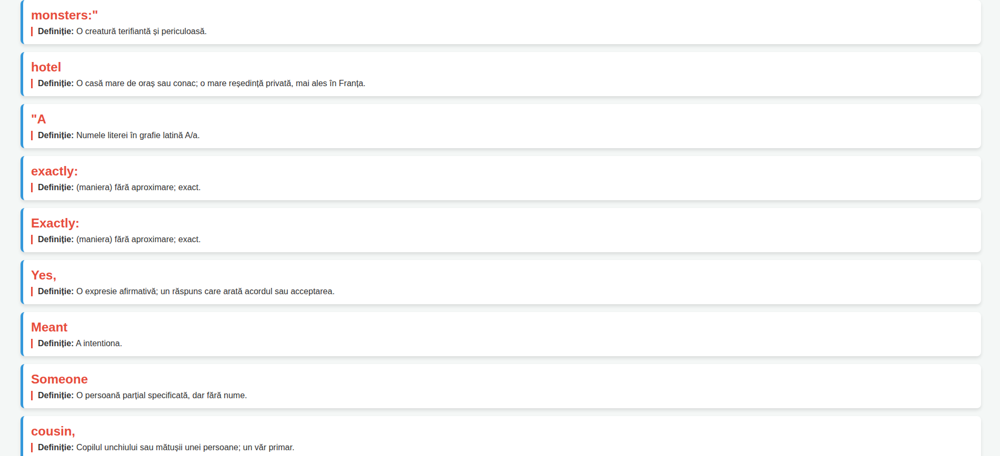

# Subtitles Translator

A Chrome extension with a Python backend that reads the subtitles from any movie site, translates them in real time and explains every unknown word when you hover over it.

## Motivation

The idea came to me when I started learning French this summer. To learn a language you first need to consume it, and the best way to do that is by watching movies. Each word you don't know gets explained when you hover over it.

Many people in Romania don't speak English, especially middle-aged people who learned Russian at school. I wanted to make learning English fun for them too, so for now the project translates from English to Romanian. The target language can be changed easily.

## Quick start

- I built a Chrome extension that works on all movie sites. The tutorial below uses Brave.
- Try it on Netflix or on https://xprime.stream/ (there you can set the subtitle size and position so they line up with the captured area from the screenshot).
- For the translator to work in `fullscreen`, press `fn + F12`.
- In `setup.sh` you can choose between a **light variant** (needs Tesseract installed on the computer) and a **more accurate variant** (EasyOCR).
- If `run.sh` and `interface.py` don't work, try `app.py`.
- The **server must be on** for the extension to work.

## 1. Getting the subtitle text

The first step is getting the text. I considered three approaches:

**I) Download the subtitles using the movie name**
- Pros: efficient
- Cons: needs to be synced with the player time; Netflix doesn't give access to its player

**II) Read the subtitles directly from the player**
- Pros: easy to do for a single site that gives access to its player
- Cons: Netflix doesn't give access to its player; it would have to be built separately for each site

**III) Take a screenshot of a selected area**
- Pros: works on any site
- Cons: harder to implement; uses a lot of resources

I chose the third option because I wanted it to work everywhere, including on sites that don't expose their player and without depending on any particular streaming service.

## 2. Implementation (Python backend)

The following modules make the third option possible.

**`doText.py`**
- Takes a screenshot of the area where subtitles usually appear.
- Uses the main monitor if the user has several.

**`analyzeImage.py`**
- Analyzes the screenshot and extracts the text. It has two variants:
  - **Variant 1, EasyOCR:** very accurate, but it needs more resources (about 8 GB of free storage) and takes longer to install.
  - **Variant 2, pytesseract:** much lighter, but the extracted text is less accurate.

**`translateText.py`**
- I first considered the `translate` package, but its API has a daily usage limit.
- I settled on `deep_translator` with Google Translate, which is free and good enough.

### Problems and decisions

- **OCR quality vs. resources:** I started with pytesseract, but it wasn't accurate enough, so I switched to EasyOCR. Because EasyOCR is heavy, I let the user choose which variant to install.
- **Privacy:** everything is processed locally, so the screenshots are never shared with anyone.
- **Hover hitboxes:** to show a word's meaning on hover, I first tried one hitbox per word, which turned out to be very hard. I simplified it to one large hitbox per line and divided it into smaller ones, giving each word a share of the line proportional to its length.
- **Vocabulary list:** so you don't forget the words you hovered over, at the end of the session you get a list of them with their meanings, saved in a database.

## 3. Implementation (JavaScript frontend)

- It gets its data from `app.py`, which starts the server and provides the information.
- Everything stops when the extension is switched OFF.
- `updateSubtitle()` gets the data through `background.js`, then shows the text in `subtitleDiv`.
- `fetchDefinition()` gets the definition of a word through `background.js`.

## Tutorial

If it doesn't work, reload the page, check that the server and the extension are on, and disable your adblocker. The server can be slow to start.

**I) Add the extension**
1. Turn on developer mode in the extension settings (found under `Data/Extension`).

   

2. Click **Load unpacked**, go to the extension's folder and add it.

   

3. Pin the extension so you can easily turn it on and off later.

**II) Run the backend**
1. Run `setup.sh` to choose the OCR variant, then run `run.sh`.
2. Click **Start server**. This lets the Python backend process the data.

   

**III) Stop the server**
1. When you finish watching, click **Stop server**. The local server stops immediately and you get the list of words you hovered over.

   

## Final notes

I really enjoyed working on this project. I had given up on the idea during the summer because I thought it was too hard.

## Future plans

- Support translation into more languages
- Train an ML model for the English version
- Build a better-looking interface
